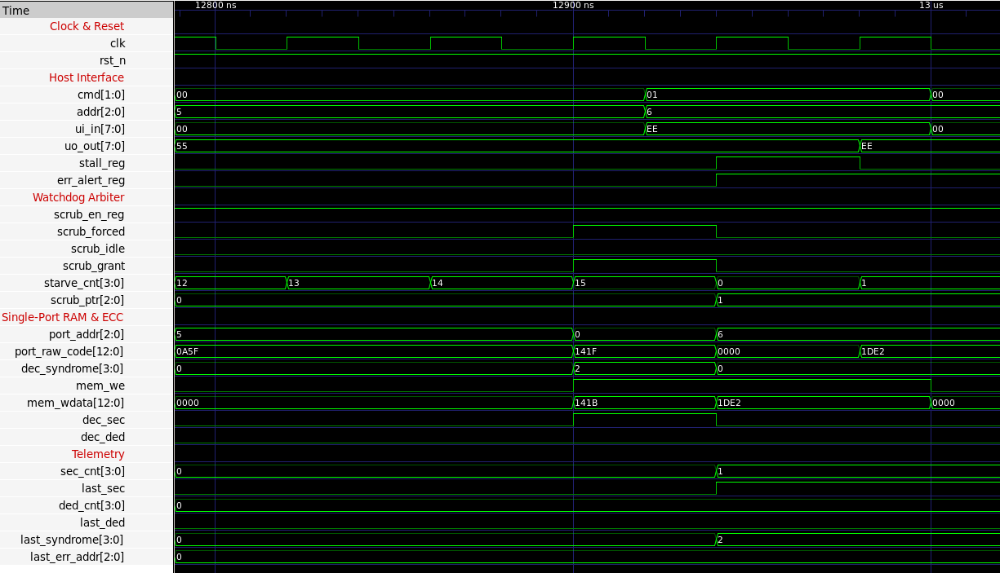
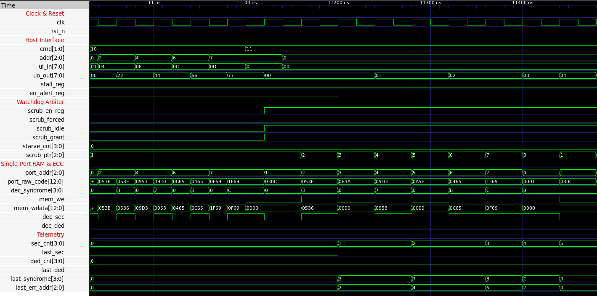
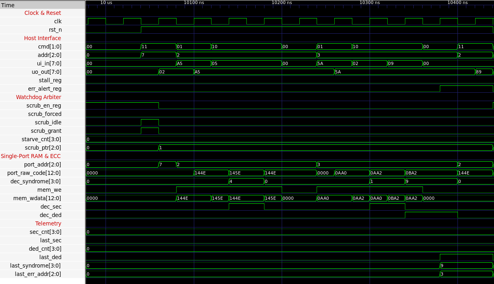

   

# 8×13-bit Hamming(13,8) SECDED ECC-Protected Scrubbing Memory

A digital ASIC implementing an **8-byte single-port Hamming(13,8) Single-Error-Correcting, Double-Error-Detecting (SECDED) register memory** with a **3-tier starvation-preventing cycle-stealing arbiter**, targeted Single-Event Upset (SEU) fault injection, and live diagnostic telemetry.

- [Read the full project datasheet](docs/info.md)

## Overview

This design packs a radiation-hardened, self-healing ECC memory controller onto a single Tiny Tapeout tile (`tt_um_ecc_prot_scrub_mem`):

1. **8×13-bit Single-Port ECC Register File:** Stores 8 bytes encoded as 13-bit extended Hamming codewords, resetting cleanly to `13'd0` (valid codeword for `0x00`).
2. **Targeted SEU Fault Injector:** Intentionally flips 0, 1, or 2 bits directly inside any stored memory word (`mem[addr]`) to simulate radiation-induced bit flips in real time.
3. **3-Tier Watchdog Arbiter & Shared SECDED Decoder:**
   - **Mandatory Cycle-Steal:** Prevents scrubber starvation by counting consecutive host memory ops (`starve_cnt`). At `15`, the arbiter preempts the next host op for 1 cycle to scrub `mem[scrub_ptr]`, holds `uo_out`, and asserts `stall` (`uio_out[6]`).
   - **Normal Host Access:** Executes `CMD_READ` (with on-the-fly single-bit healing), `CMD_WRITE`, and `CMD_INJECT` immediately with `stall = 0`.
   - **Opportunistic Idle Scrubbing:** Uses non-clearing `CMD_TELEM` cycles (`uio_in[3] = 0`) to sweep `scrub_ptr` (`0x0`–`0x7`) for free (`stall = 0`), permanently writing healed codewords back to RAM.
4. **CSR Control & Diagnostic Telemetry:** Includes an internal `scrub_en` CSR (enabled by default on reset), 4-bit saturating `sec_cnt` and `ded_cnt` counters, `scrub_ptr`, `last_err_addr`, `last_syndrome`, `starve_cnt`, and a sticky `err_alert` output (`uio_out[7]`).

## Architecture

```text
ui_in[7:0] (data_in / fault_cfg / csr_val)      uio_in[2:0] (addr), uio_in[3] (clr), uio_in[5:4] (cmd)
   │                                                                   │
   ├──► [hamming13_encoder] ──────────────────────┐                    ▼
   │                                              │       ┌─────────────────────────┐
   │  ┌─[fault_injector]◄──(port_raw_code)──┐     │       │ 3-Tier Watchdog Arbiter │
   │  │                                     │     │       │ (starve_cnt, scrub_ptr, │
   │  ▼                                     │     ▼       │  internal scrub_en CSR) │
   │  └────────► [Single-Port Write Mux] ───┴───► ┌───────────────────────────┐     │
   │                                              │  8 × 13-bit Single-Port   │◄────┘
   │                                              │     ECC Register File     │
   │                                              │ (104 DFFs, resets to 0x00)│
   │                                              └─────────────┬─────────────┘
   │                                                            │ port_raw_code (mem[port_addr])
   │                                                            ▼
   │                                              ┌───────────────────────────┐
   │                                              │   Shared SECDED Decoder   │
   │                                              │     (syndrome_calc +      │
   │                                              │     secded_corrector)     │
   │                                              └──────┬────────────┬───────┘
   │                                                     │            ├──► Healed 13b writeback
   │                                                     │            └──► Telemetry & Counters
   │                                                     ▼                 (sec_cnt, ded_cnt, last_*)
   │                                              ┌────────────────────────────────────┐
   │                                              │ Output, Stall & Alert Registers    │
   │                                              └───────┬────────────────────┬───────┘
   │                                                      ▼                    ▼
   │                                                 uo_out[7:0]          uio_out[7:6]
   │                                             (data_out / telem)   (err_alert, stall)
```

## Pinout

| Port | Direction | Signal | Description |
| --- | --- | --- | --- |
| `ui_in[7:0]` | Input | `data_in` / `fault_cfg` / `csr_val` | Write byte (`CMD_WRITE`), `{3'b0, err_double, err_pos[3:0]}` (`CMD_INJECT`), or `ui_in[0] = scrub_en` (`CMD_TELEM` with `uio_in[2]=1`) |
| `uo_out[7:0]` | Output | `data_out` / `telem` | Healed read byte (`CMD_READ`), write-through echo, or telemetry byte (`CMD_TELEM`); holds value on `stall` |
| `uio[2:0]` | Input | `addr[2:0]` / `telem_ctrl` | RAM address (`0x0`–`0x7`). During `CMD_TELEM`: `[1:0]` = reg select, `[2]` = `csr_we` (`scrub_en <= ui_in[0]`) |
| `uio[3]` | Input | `telem_clr` | During `CMD_TELEM`: `1` = atomically clear counters/latches/`err_alert` and pause scrubber for that cycle |
| `uio[5:4]` | Input | `cmd[1:0]` | `00` = Read, `01` = Write, `10` = Inject Fault, `11` = Telemetry / CSR |
| `uio[6]` | Output | `stall` | High for 1 cycle when the watchdog arbiter preempts a host memory op to run a mandatory scrub |
| `uio[7]` | Output | `err_alert` | Sticky alert flag (asserts on any SEC/DED event; cleared by `rst_n` or `CMD_TELEM` with `uio_in[3]=1`) |

Bidirectional pin direction mask: `uio_oe = 8'b1100_0000`

## Telemetry & CSR Register Map

| `uio_in[1:0]` | `uo_out[7:4]` | `uo_out[3:0]` | Description |
| --- | --- | --- | --- |
| `00` | `ded_cnt[3:0]` | `sec_cnt[3:0]` | 4-bit saturating scrubber error counters (cap at `15`) |
| `01` | `{1'b0, scrub_ptr[2:0]}` | `{1'b0, last_err_addr[2:0]}` | Current scrubber address pointer (`0`–`7`) and last faulted address (`0`–`7`) |
| `10` | `{last_ded, last_sec, 2'b00}` | `last_syndrome[3:0]` | Most recent error classification and 4-bit syndrome |
| `11` | `starve_cnt[3:0]` | `{2'b00, scrub_en, err_alert}` | Watchdog starvation counter, internal `scrub_en` CSR, and sticky alert |

*Setting `uio_in[2] = 1` updates `scrub_en <= ui_in[0]`. Setting `uio_in[3] = 1` returns the pre-clear snapshot and atomically resets all counters, diagnostic latches, and `err_alert` to `0`.*

## Verification

The design is verified using a sign-off Cocotb testbench (`test/test_scrub_mem.py`) checked cycle-by-cycle against an independent Python golden scoreboard, covering:

* Synchronous reset override under active writes/injections, default `scrub_en = 1`, and `uio_oe = 8'b1100_0000` checks
* CSR `scrub_en` transition boundary semantics, combined `csr_we + telem_clr`, and `starve_cnt` hold behavior
* All 16 `err_pos` values (`0`–`15`) for both `err_double = 0` and `err_double = 1` (including out-of-range and `err_pos = 13` wrap-around)
* Cumulative multi-cycle fault injection (same-bit cancellation and distinct-bit escalation to DED)
* Opportunistic idle scrubbing (`stall = 0`) and permanent in-RAM healing across all 8 slots
* Watchdog cycle-stealing after 15 consecutive host ops (`stall = 1`, `uo_out` hold, and clean host retry for `CMD_WRITE`, `CMD_INJECT`, and `CMD_READ`)
* Zero-stall guarantee when `scrub_en = 0`, both `sec_cnt` and `ded_cnt` saturation at `15`, mid-operation reset, and unused `uio_in[7:6]` immunity
* 3,000-cycle deterministic pseudo-random stress test with automatic host retries and periodic full-RAM + full-telemetry audits

#### Commands

```sh
cd test
make -B             # Run RTL simulation (Icarus Verilog + Cocotb)
make -B GATES=yes   # Run Gate-Level Simulation (requires gate_level_netlist.v)
gtkwave tb.fst tb.gtkw
```

#### Waveforms

1. **Watchdog Cycle-Stealing & `stall` Handshake:**



As one can see, back-to-back host reads (`cmd = 00`, `addr = 5`, returning `uo_out = 55`) increment `starve_cnt` from `12` to `15`, triggering `scrub_forced = 1` and `scrub_grant = 1`. So when the host attempts `CMD_WRITE` (`cmd = 01`, `ui_in = EE` to `addr = 6`), the arbiter overrides `port_addr` to `scrub_ptr = 0`. The shared decoder detects a single-bit error in `mem[0]` (`port_raw_code = 141F`, `dec_syndrome = 2`, `dec_sec = 1`) and drives `mem_we = 1` with the healed codeword `141B`. On the rising clock edge, `stall_reg` pulses high for 1 cycle, `uo_out` holds `55` (protecting the host bus), `mem[0]` is permanently healed, `sec_cnt` increments (`0 → 1`), `err_alert_reg` latches high (`last_err_addr = 0`, `last_syndrome = 2`), `scrub_ptr` advances (`0 → 1`), and `starve_cnt` resets to `0`. The host holds `CMD_WRITE` (`EE` to `addr = 6`) for one cycle. With `scrub_forced = 0`, `port_addr` switches to `6`, `mem_wdata` encodes `EE` to `1DE2`, `stall_reg` clears to `0`, and `uo_out` echoes `EE`.

2. **Zero-Stall Opportunistic Idle Scrubbing:**



With `scrub_en_reg = 0`, five single-bit faults are injected via `CMD_INJECT` (`cmd = 10`) into addresses `0` (`err_pos = 01`: `0000 → 0001`), `2` (`04`: `0536 → 053E`), `4` (`08`: `0953 → 09D3`), `6` (`0C`: `0C65 → 0465`), and `7` (`0D`: `0F69 → 1F69`) while `uo_out` returns each word's pre-injection byte. Writing `ui_in = 01` to `CMD_TELEM` (`cmd = 11`, `addr = 7`) sets `scrub_en_reg = 1`. Holding `cmd = 11`, `addr = 0` (reading telemetry register `00`) keeps `scrub_idle = 1` and `scrub_grant = 1` continuously while `stall_reg` and `starve_cnt` stay `0`. As `scrub_ptr` sweeps `1 → 2 → 3 → 4 → 5 → 6 → 7 → 0`, clean words (`1`, `3`, `5`) are skipped (`mem_we = 0`), while all five faulted words are written back healed (`0536`, `0953`, `0C65`, `0F69`, and `0000` for the overall-parity `P0` flip at `addr = 0` with `dec_syndrome = 0`). `sec_cnt` climbs `0 → 5`, `err_alert_reg` latches high, and `uo_out` live-streams the updated counter (`00 → 01 → 02 → 03 → 04`).

3. **Cumulative Fault Cancellation & Uncorrectable DED Escalation:**



- At first, `0xA5` is written to `addr = 2` (encoded as `144E`). Two sequential `CMD_INJECT` operations (`cmd = 10`, `ui_in = 05`) flip bit `4` (`144E → 145E`, `dec_syndrome = 4`, `dec_sec = 1`) and then flip it back (`145E → 144E`). The subsequent `CMD_READ` (`cmd = 00`) sees `dec_syndrome = 0`, returning `uo_out = A5` with `err_alert_reg = 0`.
- Now, `0x5A` is written to `addr = 3` (encoded as `0AA0`). Two distinct single-bit injections—`ui_in = 02` (`0AA0 → 0AA2`) followed by `ui_in = 09` (`0AA2 → 0BA2`)—accumulate into a 2-bit error. Reading `addr = 3` (`cmd = 00`) asserts `dec_ded = 1` with `dec_syndrome = 9` and `mem_we = 0` (preventing false correction). On the rising edge, `err_alert_reg` and `last_ded` latch high with `last_err_addr = 3` and `last_syndrome = 9`; the following `CMD_TELEM` read (`addr = 2`) reports `uo_out = 89` (`{last_ded=1, last_sec=0, 2'b00, 4'h9}`).

## Repository Layout

* `docs/info.md` — Datasheet documentation
* `src/design_top.v` — Top-level RTL (`tt_um_ecc_prot_scrub_mem`: 8×13-bit single-port RAM, watchdog arbiter, scrubber FSM, and telemetry)
* `src/submodules.v` — Hamming(13,8) encoder, fault injector, syndrome calculator, and SECDED corrector
* `src/config.json` — LibreLane hardening configuration
* `test/Makefile` — Makefile for compiling and running RTL simulation & GLS
* `test/test_scrub_mem.py` — Sign-off Cocotb verification testbench with golden scoreboard
* `test/tb.v` — Verilog testbench wrapper (RTL + GLS power-pin support)
* `info.yaml` — Tiny Tapeout shuttle metadata and pinout

## About Tiny Tapeout

Built for [Tiny Tapeout](https://tinytapeout.com) using [LibreLane](https://www.zerotoasiccourse.com/terminology/librelane/).
