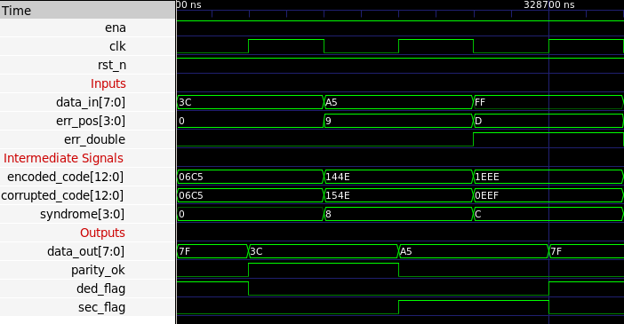

   

# Hamming(13,8) SECDED Error Corrector & Fault Injector

A digital ASIC implementing an inline **Hamming(13,8) Single-Error-Correcting, Double-Error-Detecting (SECDED) codec** with an on-chip fault injector and live status flags.

- [Read the full project datasheet](docs/info.md)

## Overview

This design packs a complete Forward Error Correction (FEC) pipeline onto a single Tiny Tapeout tile (`tt_um_secded_13_8`):

1. **Hamming(13,8) Encoder:** Appends 4 Hamming parity bits (`P1, P2, P4, P8`) and 1 overall even-parity bit (`P0`) to an 8-bit input byte (`ui_in[7:0]`) to form a 13-bit codeword.
2. **On-Chip Fault Injector:** Intentionally flips 0, 1, or 2 distinct codeword bits using `uio_in[4:0]` to simulate channel noise or single-event upsets in real time.
3. **Syndrome Calculator:** Recomputes the 4-bit syndrome `S[3:0]` and overall parity `p_tot` using combinational XOR trees.
4. **SECDED Corrector & Output Register:** Automatically corrects any single-bit error, flags uncorrectable double-bit errors without miscorrecting data, and registers all outputs on `posedge clk` (1-cycle latency).

## Architecture

```text
  ui_in[7:0] (data_in)
           │
           ▼
┌─────────────────────┐
│  hamming13_encoder  │  Computes P1, P2, P4, P8 + overall even parity P0 (13-bit codeword)
└──────────┬──────────┘
           ▼
┌─────────────────────┐
│   fault_injector    │◄── uio_in[3:0] (err_pos), uio_in[4] (err_double)
└──────────┬──────────┘
           ▼
┌─────────────────────┐
│    syndrome_calc    │  Computes 4-bit syndrome S[3:0] and overall parity p_tot
└──────────┬──────────┘
           ▼
┌─────────────────────┐
│  secded_corrector   │  Flips single-bit errors; flags uncorrectable double-bit errors
└──────────┬──────────┘
           ▼
┌─────────────────────┐
│   Output Register   │  Registered on posedge clk (1-cycle latency, synchronous rst_n)
└──────────┬──────────┘
           ├──► uo_out[7:0]  (corrected data_out)
           └──► uio_out[7:5] (parity_ok, ded_flag, sec_flag)

```

## Pinout 

| Port | Direction | Signal | Description |
| :--- | :---: | :--- | :--- |
| `ui_in[7:0]` | Input | `data_in[7:0]` | Original 8-bit input data byte |
| `uo_out[7:0]` | Output | `data_out[7:0]` | Corrected 8-bit output byte |
| `uio[3:0]` | Input | `err_pos[3:0]` | Fault bit position `1`–`13` (`0`, `14`, `15` = no fault) |
| `uio[4]` | Input | `err_double` | `1` = inject 2 distinct bit flips simultaneously (tests DED) |
| `uio[5]` | Output | `sec_flag` | High when a 1-bit error was detected and corrected |
| `uio[6]` | Output | `ded_flag` | High when an uncorrectable 2-bit error is detected |
| `uio[7]` | Output | `parity_ok` | High when the codeword is error-free |

    Bidirectional pins config: `uio_oe = 8'b1110_0000`

## Status Flag Decoding

| **Condition** | `parity_ok` | `ded_flag` | `sec_flag` | **Output Behavior** |
| :--- | :-: | :-: | :-: | :--- |
| *No Error* | 1 | 0 | 0 | `data_out == data_in` |
| *Single-Bit Error* | 0 | 0 | 1 | Corrupted bit corrected; `data_out == data_in` |
| *Double-Bit Error* | 0 | 1 | 0 | Uncorrectable error flagged; no miscorrection applied |

## Verification

The design is verified using an exhaustive Cocotb testbench (`test/test_secded.py`) against an independent Python golden reference model, covering:
- Synchronous reset and `uio_oe` pin-direction checks
- All 8,192 input combinations (`256` data bytes × `32` fault states) streamed back-to-back at 1 vector/cycle
- Out-of-range `err_pos` values (`0`, `14`, `15`), mid-operation reset recovery, and unused `uio_in[7:5]` immunity

**Commands:**
```sh
cd test
make -B             # Run RTL simulation (Icarus Verilog + Cocotb)
make -B GATES=yes   # Run Gate-Level Simulation (requires gate_level_netlist.v)
gtkwave tb.fst tb.gtkw
```

**Waveform:**



**Waveform Interpretation:**

The above waveform shows 3 distinct possible error case examples for this digital circuit:
* In first example, `data_in = 3C`, `err_pos = 0` and `err_double = 0` i.e., **no fault injected**. The `encoded_code` and `corrupted_code` correctly match. The output `data_out` matches the input `data_in` after 1 cycle latency, and the flags (`parity_ok`, `ded_flag`, `sec_flag`) correctly output (`1`, `0`, `0`) respectively.
* In second example, `data_in = A5`, `err_pos = 9` and `err_double = 0` i.e., **single-bit fault injected**. The `encoded_code` and `corrupted_code` correctly differs at bit index `8`, correctly indicated by syndrome value. The output `data_out` matches the input `data_in` due to single-error correction, and the flags (`parity_ok`, `ded_flag`, `sec_flag`) correctly output (`0`, `0`, `1`) respectively.
* In third example, `data_in = FF`, `err_pos = D` and `err_double = 1` i.e., **double-bit fault injected**. The `encoded_code` and `corrupted_code` correctly differs at bit indices `12` and `0`, but syndrome value (`C`) can only locate one error at index `12`. The output `data_out` doesn't match the input `data_in` because two simultaneous errors can't be corrected, and the flags (`parity_ok`, `ded_flag`, `sec_flag`) correctly output (`0`, `1`, `0`) respectively.

## Repository Layout

* `docs/info.md` — Datasheet documentation
* `src/secded_13_8.v` — Synthesizable Verilog RTL (`tt_um_secded_13_8` + 4 submodules)
* `src/config.json` — LibreLane hardening configuration
* `test/Makefile` — Makefile for compiling and running RTL simulation & GLS
* `test/test_secded.py` — Exhaustive Cocotb verification suite
* `test/tb.v` — Verilog testbench wrapper (RTL + GLS power-pin support)
* `info.yaml` — Tiny Tapeout shuttle metadata and pinout


## About Tiny Tapeout

Built for [Tiny Tapeout](https://tinytapeout.com) using [LibreLane](https://www.zerotoasiccourse.com/terminology/librelane/).

